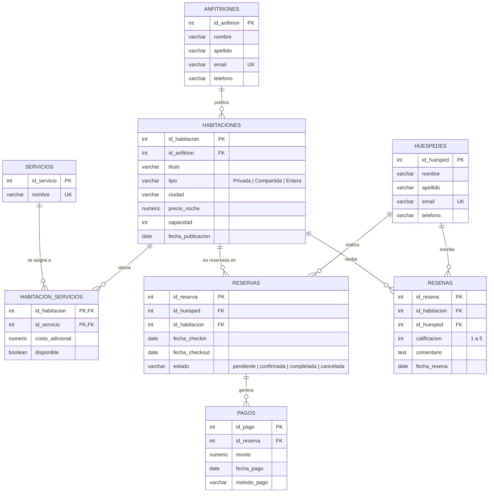

# Inmobiliaria — Modelo relacional y consultas SQL (PostgreSQL)

> **Cómo leer este documento:** el script está pensado para ejecutarse **en orden, de arriba abajo**, sobre una base de datos vacía.
> Los resultados que se muestran debajo de cada consulta reflejan el estado de los datos **en ese momento**: la Parte 2 muestra los datos recién insertados, y a partir de la Parte 5 los datos ya incluyen los cambios hechos en las Partes 3 (UPDATE) y 4 (DELETE).

## Modelo entidad-relación (DER)



### Modelo relacional

- **anfitriones** (<u>id_anfitrion</u>, nombre, apellido, email, telefono)
- **huespedes** (<u>id_huesped</u>, nombre, apellido, email, telefono)
- **habitaciones** (<u>id_habitacion</u>, *id_anfitrion* → anfitriones, titulo, tipo, ciudad, precio_noche, capacidad, fecha_publicacion)
- **servicios** (<u>id_servicio</u>, nombre)
- **habitacion_servicios** (<u>*id_habitacion*</u> → habitaciones, <u>*id_servicio*</u> → servicios, costo_adicional, disponible) — tabla intermedia de la relación N:M entre habitaciones y servicios
- **reservas** (<u>id_reserva</u>, *id_huesped* → huespedes, *id_habitacion* → habitaciones, fecha_checkin, fecha_checkout, estado)
- **pagos** (<u>id_pago</u>, *id_reserva* → reservas, monto, fecha_pago, metodo_pago)
- **resenas** (<u>id_resena</u>, *id_habitacion* → habitaciones, *id_huesped* → huespedes, calificacion, comentario, fecha_resena)

Decisiones de diseño:
- `nombre` y `apellido` van en columnas separadas para poder resolver tanto *"nombre sea `Carlos`"* (pregunta 25) como *"anfitrión `Carlos Ramírez`"* (pregunta 48).
- Las claves foráneas usan `ON DELETE RESTRICT` (no se puede borrar un registro padre mientras tenga hijos), salvo `habitacion_servicios.id_habitacion`, que usa `ON DELETE CASCADE`: si una habitación se elimina, sus servicios asignados no tienen sentido por sí solos.
- Se usan `CHECK` para validar dominios (tipo de habitación, estado de reserva, precios positivos, calificación de 1 a 5, check-out posterior al check-in).

## NIVEL I

### Parte 1. CREATE

**0. Crea las tablas de tu modelo de datos**

```sql
CREATE TABLE anfitriones (
    id_anfitrion  SERIAL       PRIMARY KEY,
    nombre        VARCHAR(50)  NOT NULL,
    apellido      VARCHAR(50)  NOT NULL,
    email         VARCHAR(100) NOT NULL UNIQUE,
    telefono      VARCHAR(20)
);

CREATE TABLE huespedes (
    id_huesped    SERIAL       PRIMARY KEY,
    nombre        VARCHAR(50)  NOT NULL,
    apellido      VARCHAR(50)  NOT NULL,
    email         VARCHAR(100) NOT NULL UNIQUE,
    telefono      VARCHAR(20)
);

CREATE TABLE habitaciones (
    id_habitacion     SERIAL        PRIMARY KEY,
    id_anfitrion      INT           NOT NULL REFERENCES anfitriones (id_anfitrion) ON DELETE RESTRICT,
    titulo            VARCHAR(100)  NOT NULL,
    tipo              VARCHAR(20)   NOT NULL CHECK (tipo IN ('Privada', 'Compartida', 'Entera')),
    ciudad            VARCHAR(50)   NOT NULL,
    precio_noche      NUMERIC(10,2) NOT NULL CHECK (precio_noche > 0),
    capacidad         INT           NOT NULL CHECK (capacidad > 0),
    fecha_publicacion DATE          NOT NULL DEFAULT CURRENT_DATE
);

CREATE TABLE servicios (
    id_servicio   SERIAL      PRIMARY KEY,
    nombre        VARCHAR(50) NOT NULL UNIQUE
);

CREATE TABLE habitacion_servicios (
    id_habitacion   INT           NOT NULL REFERENCES habitaciones (id_habitacion) ON DELETE CASCADE,
    id_servicio     INT           NOT NULL REFERENCES servicios (id_servicio) ON DELETE RESTRICT,
    costo_adicional NUMERIC(10,2) NOT NULL DEFAULT 0 CHECK (costo_adicional >= 0),
    disponible      BOOLEAN       NOT NULL DEFAULT TRUE,
    PRIMARY KEY (id_habitacion, id_servicio)
);

CREATE TABLE reservas (
    id_reserva     SERIAL      PRIMARY KEY,
    id_huesped     INT         NOT NULL REFERENCES huespedes (id_huesped) ON DELETE RESTRICT,
    id_habitacion  INT         NOT NULL REFERENCES habitaciones (id_habitacion) ON DELETE RESTRICT,
    fecha_checkin  DATE        NOT NULL,
    fecha_checkout DATE        NOT NULL,
    estado         VARCHAR(20) NOT NULL DEFAULT 'pendiente'
                   CHECK (estado IN ('pendiente', 'confirmada', 'completada', 'cancelada')),
    CHECK (fecha_checkout > fecha_checkin)
);

CREATE TABLE pagos (
    id_pago      SERIAL        PRIMARY KEY,
    id_reserva   INT           NOT NULL REFERENCES reservas (id_reserva) ON DELETE RESTRICT,
    monto        NUMERIC(12,2) NOT NULL CHECK (monto > 0),
    fecha_pago   DATE          NOT NULL DEFAULT CURRENT_DATE,
    metodo_pago  VARCHAR(20)   NOT NULL CHECK (metodo_pago IN ('tarjeta', 'transferencia', 'efectivo'))
);

CREATE TABLE resenas (
    id_resena     SERIAL  PRIMARY KEY,
    id_habitacion INT     NOT NULL REFERENCES habitaciones (id_habitacion) ON DELETE RESTRICT,
    id_huesped    INT     NOT NULL REFERENCES huespedes (id_huesped) ON DELETE RESTRICT,
    calificacion  INT     NOT NULL CHECK (calificacion BETWEEN 1 AND 5),
    comentario    TEXT,
    fecha_resena  DATE    NOT NULL DEFAULT CURRENT_DATE
);
```

Resultado: `CREATE TABLE` (×8). Se crean las 8 tablas vacías.

**1. Inserta registros en las tablas creadas. (Inserta los registros MÍNIMOS necesarios para poder dar al menos una respuesta a las peticiones SQL que se piden en el ejercicio)**

```sql
INSERT INTO anfitriones (nombre, apellido, email, telefono) VALUES
    ('Carlos', 'Ramírez',  'carlos.ramirez@email.com', '3001112233'),
    ('Laura',  'Gómez',    'laura.gomez@email.com',    '3102223344'),
    ('Luis',   'Martínez', 'luis.martinez@email.com',  '3203334455');

INSERT INTO huespedes (nombre, apellido, email, telefono) VALUES
    ('Paula', 'Ríos',    'paula.rios@email.com',    '3014445566'),
    ('Mateo', 'Herrera', 'mateo.herrera@email.com', '3115556677'),
    ('María', 'López',   'maria.lopez@email.com',   '3156667788');

INSERT INTO habitaciones (id_anfitrion, titulo, tipo, ciudad, precio_noche, capacidad, fecha_publicacion) VALUES
    (1, 'Loft Central',                'Privada',    'Bogotá',    150000, 2, '2024-02-10'),
    (1, 'Suite Norte',                 'Privada',    'Bogotá',    220000, 2, '2024-05-01'),
    (2, 'Habitación Centro Histórico', 'Compartida', 'Cartagena',  70000, 4, '2023-11-05'),
    (3, 'Cuarto Compartido Poblado',   'Compartida', 'Medellín',   85000, 3, '2024-03-15'),
    (2, 'Apartamento Laureles',        'Entera',     'Medellín',  180000, 5, '2023-08-20');

INSERT INTO servicios (nombre) VALUES
    ('Wi-Fi'),
    ('Parqueadero'),
    ('Desayuno'),
    ('Aire acondicionado');

INSERT INTO habitacion_servicios (id_habitacion, id_servicio, costo_adicional, disponible) VALUES
    (1, 1,     0, TRUE),   -- Loft Central: Wi-Fi
    (1, 2, 15000, TRUE),   -- Loft Central: Parqueadero
    (1, 3, 25000, TRUE),   -- Loft Central: Desayuno
    (2, 1,     0, TRUE),   -- Suite Norte: Wi-Fi
    (2, 4, 20000, FALSE),  -- Suite Norte: Aire acondicionado (no disponible)
    (3, 1,     0, TRUE);   -- Habitación Centro Histórico: Wi-Fi

INSERT INTO reservas (id_huesped, id_habitacion, fecha_checkin, fecha_checkout, estado) VALUES
    (1, 2, '2024-06-10', '2024-06-14', 'completada'),  -- Paula en Suite Norte
    (1, 1, '2025-03-01', '2025-03-05', 'pendiente'),   -- Paula en Loft Central
    (2, 3, '2024-07-20', '2024-07-22', 'completada'),  -- Mateo en Centro Histórico
    (3, 5, '2024-08-05', '2024-08-10', 'cancelada'),   -- María en Apartamento Laureles
    (3, 1, '2025-04-10', '2025-04-13', 'pendiente');   -- María en Loft Central

INSERT INTO pagos (id_reserva, monto, fecha_pago, metodo_pago) VALUES
    (1, 880000, '2024-06-01', 'tarjeta'),
    (2, 600000, '2025-02-15', 'transferencia'),
    (3, 140000, '2024-07-15', 'efectivo');

INSERT INTO resenas (id_habitacion, id_huesped, calificacion, comentario, fecha_resena) VALUES
    (2, 1, 5, 'Excelente vista y muy limpia',  '2024-06-15'),
    (3, 2, 4, 'Buena ubicación, algo ruidosa', '2024-07-23');
```

Resultado: `INSERT 0 3`, `INSERT 0 3`, `INSERT 0 5`, `INSERT 0 4`, `INSERT 0 6`, `INSERT 0 5`, `INSERT 0 3`, `INSERT 0 2`.

¿Por qué estos registros y no menos? Cada dato cubre al menos una pregunta:
- 2 anfitriones cuyo nombre empieza por `L` (26) y 2 con más de una habitación (70); `Carlos Ramírez` (25, 48).
- 2 huéspedes cuyo nombre empieza por `M` (27); `Paula Ríos` con 2 reservas (49, 72).
- Habitaciones de los 3 tipos, con 2 tipos repetidos (64, 71); precios dentro y fuera de los rangos pedidos (23, 34); fechas antes y después de 2024 (24); un título con `Centro` (28); ciudades Bogotá/Medellín y otra distinta (37).
- Habitaciones con y sin servicios (54, 55), con y sin reseñas (52, 53), y con más de un servicio incluso después de borrar uno (15, 73).
- Una reserva cancelada sin pagos para poder borrarla sin romper la integridad (16), y dos pendientes para que quede una después del UPDATE (11, 21).

### Parte 2. READ

**2. Mostrar todos los registros de la tabla `anfitriones`.**

```sql
SELECT * FROM anfitriones;
```

| id_anfitrion | nombre | apellido | email | telefono |
|---|---|---|---|---|
| 1 | Carlos | Ramírez | carlos.ramirez@email.com | 3001112233 |
| 2 | Laura | Gómez | laura.gomez@email.com | 3102223344 |
| 3 | Luis | Martínez | luis.martinez@email.com | 3203334455 |

**3. Mostrar todos los registros de la tabla `huespedes`.**

```sql
SELECT * FROM huespedes;
```

| id_huesped | nombre | apellido | email | telefono |
|---|---|---|---|---|
| 1 | Paula | Ríos | paula.rios@email.com | 3014445566 |
| 2 | Mateo | Herrera | mateo.herrera@email.com | 3115556677 |
| 3 | María | López | maria.lopez@email.com | 3156667788 |

**4. Mostrar todos los registros de la tabla `habitaciones`.**

```sql
SELECT * FROM habitaciones;
```

| id_habitacion | id_anfitrion | titulo | tipo | ciudad | precio_noche | capacidad | fecha_publicacion |
|---|---|---|---|---|---|---|---|
| 1 | 1 | Loft Central | Privada | Bogotá | 150000.00 | 2 | 2024-02-10 |
| 2 | 1 | Suite Norte | Privada | Bogotá | 220000.00 | 2 | 2024-05-01 |
| 3 | 2 | Habitación Centro Histórico | Compartida | Cartagena | 70000.00 | 4 | 2023-11-05 |
| 4 | 3 | Cuarto Compartido Poblado | Compartida | Medellín | 85000.00 | 3 | 2024-03-15 |
| 5 | 2 | Apartamento Laureles | Entera | Medellín | 180000.00 | 5 | 2023-08-20 |

**5. Mostrar todos los registros de la tabla `reservas`.**

```sql
SELECT * FROM reservas;
```

| id_reserva | id_huesped | id_habitacion | fecha_checkin | fecha_checkout | estado |
|---|---|---|---|---|---|
| 1 | 1 | 2 | 2024-06-10 | 2024-06-14 | completada |
| 2 | 1 | 1 | 2025-03-01 | 2025-03-05 | pendiente |
| 3 | 2 | 3 | 2024-07-20 | 2024-07-22 | completada |
| 4 | 3 | 5 | 2024-08-05 | 2024-08-10 | cancelada |
| 5 | 3 | 1 | 2025-04-10 | 2025-04-13 | pendiente |

**6. Mostrar todos los registros de la tabla `pagos`.**

```sql
SELECT * FROM pagos;
```

| id_pago | id_reserva | monto | fecha_pago | metodo_pago |
|---|---|---|---|---|
| 1 | 1 | 880000.00 | 2024-06-01 | tarjeta |
| 2 | 2 | 600000.00 | 2025-02-15 | transferencia |
| 3 | 3 | 140000.00 | 2024-07-15 | efectivo |

**7. Mostrar solo el nombre y el email de los anfitriones.**

```sql
SELECT nombre, email FROM anfitriones;
```

| nombre | email |
|---|---|
| Carlos | carlos.ramirez@email.com |
| Laura | laura.gomez@email.com |
| Luis | luis.martinez@email.com |

**8. Mostrar solo el título, tipo y ciudad de las habitaciones.**

```sql
SELECT titulo, tipo, ciudad FROM habitaciones;
```

| titulo | tipo | ciudad |
|---|---|---|
| Loft Central | Privada | Bogotá |
| Suite Norte | Privada | Bogotá |
| Habitación Centro Histórico | Compartida | Cartagena |
| Cuarto Compartido Poblado | Compartida | Medellín |
| Apartamento Laureles | Entera | Medellín |

**9. Mostrar el nombre y teléfono de los huéspedes.**

```sql
SELECT nombre, telefono FROM huespedes;
```

| nombre | telefono |
|---|---|
| Paula | 3014445566 |
| Mateo | 3115556677 |
| María | 3156667788 |

### Parte 3. UPDATE

> Todas las actualizaciones filtran por clave primaria en el `WHERE`, para modificar exactamente una fila. Un `UPDATE` sin `WHERE` cambiaría **todas** las filas de la tabla.

**10. Actualizar el teléfono de un anfitrión.**

```sql
UPDATE anfitriones
SET telefono = '3109998877'
WHERE id_anfitrion = 2;   -- Laura Gómez
```

Resultado: `UPDATE 1`. El teléfono de Laura Gómez pasa de `3102223344` a `3109998877`.

**11. Cambiar el estado de una reserva de `pendiente` a `confirmada`.**

```sql
UPDATE reservas
SET estado = 'confirmada'
WHERE id_reserva = 2
  AND estado = 'pendiente';
```

Resultado: `UPDATE 1`. La reserva 2 (Paula Ríos en Loft Central) queda `confirmada`. La condición `estado = 'pendiente'` evita "confirmar" por error una reserva cancelada o completada.

**12. Actualizar el precio por noche de una habitación.**

```sql
UPDATE habitaciones
SET precio_noche = 160000
WHERE id_habitacion = 1;  -- Loft Central
```

Resultado: `UPDATE 1`. Loft Central pasa de `150000.00` a `160000.00`.

**13. Cambiar el costo adicional de un servicio asignado a una habitación.**

```sql
UPDATE habitacion_servicios
SET costo_adicional = 30000
WHERE id_habitacion = 1   -- Loft Central
  AND id_servicio = 3;    -- Desayuno
```

Resultado: `UPDATE 1`. El desayuno de Loft Central pasa de `25000.00` a `30000.00`. Como la clave primaria es compuesta, el `WHERE` necesita las dos columnas.

**14. Actualizar el monto de un pago.**

```sql
UPDATE pagos
SET monto = 640000
WHERE id_pago = 2;
```

Resultado: `UPDATE 1`. El pago 2 pasa de `600000.00` a `640000.00` (4 noches × el nuevo precio de 160000).

### Parte 4. DELETE

**15. Eliminar un servicio asignado a una habitación.**

```sql
DELETE FROM habitacion_servicios
WHERE id_habitacion = 1   -- Loft Central
  AND id_servicio = 2;    -- Parqueadero
```

Resultado: `DELETE 1`. Loft Central deja de ofrecer parqueadero. El servicio `Parqueadero` sigue existiendo en la tabla `servicios`; solo se borra la asignación.

**16. Eliminar una reserva específica.**

```sql
DELETE FROM reservas
WHERE id_reserva = 4;     -- reserva cancelada de María López
```

Resultado: `DELETE 1`. Funciona porque la reserva 4 no tiene pagos asociados. Si intentáramos borrar una reserva con pagos (por ejemplo la 1), PostgreSQL lo impediría por la clave foránea `pagos_id_reserva_fkey`.

**17. Intentar eliminar una habitación que tenga reservas o reseñas y explicar qué ocurre y por qué.**

```sql
DELETE FROM habitaciones
WHERE id_habitacion = 2;  -- Suite Norte: tiene la reserva 1 y la reseña 1
```

Resultado:

```
ERROR:  update or delete on table "habitaciones" violates foreign key constraint "reservas_id_habitacion_fkey" on table "reservas"
DETAIL:  Key (id_habitacion)=(2) is still referenced from table "reservas".
```

**¿Qué ocurre y por qué?** PostgreSQL rechaza el borrado y la habitación sigue existiendo. La tabla `reservas` tiene una clave foránea `id_habitacion` que apunta a `habitaciones`, definida con `ON DELETE RESTRICT`. Si se borrara la Suite Norte, la reserva 1 quedaría apuntando a una habitación que ya no existe (un registro huérfano), y eso rompe la **integridad referencial**. Lo mismo pasaría con la reseña 1 por `resenas_id_habitacion_fkey`; el mensaje solo nombra la primera restricción que falla.

Aunque `habitacion_servicios` sí tiene `ON DELETE CASCADE`, el borrado de sus filas tampoco ocurre: la sentencia completa falla y se revierte entera (atomicidad). Para eliminar la habitación habría que borrar antes sus reseñas, los pagos de sus reservas y sus reservas, o haber definido esas claves con `ON DELETE CASCADE` (lo cual borraría historial de negocio, así que no es recomendable aquí).

**18. Intentar eliminar un anfitrión que tenga habitaciones registradas y explicar qué ocurre y por qué.**

```sql
DELETE FROM anfitriones
WHERE id_anfitrion = 1;   -- Carlos Ramírez: tiene Loft Central y Suite Norte
```

Resultado:

```
ERROR:  update or delete on table "anfitriones" violates foreign key constraint "habitaciones_id_anfitrion_fkey" on table "habitaciones"
DETAIL:  Key (id_anfitrion)=(1) is still referenced from table "habitaciones".
```

**¿Qué ocurre y por qué?** El borrado falla y Carlos Ramírez sigue registrado. La columna `habitaciones.id_anfitrion` es una clave foránea `NOT NULL` hacia `anfitriones` con `ON DELETE RESTRICT`: toda habitación debe tener un anfitrión válido. Si se permitiera el borrado, Loft Central y Suite Norte quedarían sin dueño. Para eliminar al anfitrión habría que reasignar sus habitaciones a otro anfitrión (`UPDATE habitaciones SET id_anfitrion = ...`) o eliminarlas antes (lo cual, a su vez, chocaría con las reservas, como en la pregunta 17).

## NIVEL II

### Parte 5. Filtros con WHERE

**19. Mostrar las habitaciones cuyo tipo sea `Privada`.**

```sql
SELECT * FROM habitaciones
WHERE tipo = 'Privada';
```

| id_habitacion | id_anfitrion | titulo | tipo | ciudad | precio_noche | capacidad | fecha_publicacion |
|---|---|---|---|---|---|---|---|
| 1 | 1 | Loft Central | Privada | Bogotá | 160000.00 | 2 | 2024-02-10 |
| 2 | 1 | Suite Norte | Privada | Bogotá | 220000.00 | 2 | 2024-05-01 |

**20. Mostrar las habitaciones cuyo tipo sea `Compartida`.**

```sql
SELECT * FROM habitaciones
WHERE tipo = 'Compartida';
```

| id_habitacion | id_anfitrion | titulo | tipo | ciudad | precio_noche | capacidad | fecha_publicacion |
|---|---|---|---|---|---|---|---|
| 3 | 2 | Habitación Centro Histórico | Compartida | Cartagena | 70000.00 | 4 | 2023-11-05 |
| 4 | 3 | Cuarto Compartido Poblado | Compartida | Medellín | 85000.00 | 3 | 2024-03-15 |

**21. Mostrar las reservas cuyo estado sea `pendiente`.**

```sql
SELECT * FROM reservas
WHERE estado = 'pendiente';
```

| id_reserva | id_huesped | id_habitacion | fecha_checkin | fecha_checkout | estado |
|---|---|---|---|---|---|
| 5 | 3 | 1 | 2025-04-10 | 2025-04-13 | pendiente |

**22. Mostrar las reservas cuyo estado sea `confirmada`.**

```sql
SELECT * FROM reservas
WHERE estado = 'confirmada';
```

| id_reserva | id_huesped | id_habitacion | fecha_checkin | fecha_checkout | estado |
|---|---|---|---|---|---|
| 2 | 1 | 1 | 2025-03-01 | 2025-03-05 | confirmada |

**23. Mostrar las habitaciones cuyo precio por noche sea mayor a `120000`.**

```sql
SELECT * FROM habitaciones
WHERE precio_noche > 120000;
```

| id_habitacion | id_anfitrion | titulo | tipo | ciudad | precio_noche | capacidad | fecha_publicacion |
|---|---|---|---|---|---|---|---|
| 1 | 1 | Loft Central | Privada | Bogotá | 160000.00 | 2 | 2024-02-10 |
| 2 | 1 | Suite Norte | Privada | Bogotá | 220000.00 | 2 | 2024-05-01 |
| 5 | 2 | Apartamento Laureles | Entera | Medellín | 180000.00 | 5 | 2023-08-20 |

**24. Mostrar las habitaciones publicadas después del `1 de enero de 2024`.**

```sql
SELECT * FROM habitaciones
WHERE fecha_publicacion > '2024-01-01';
```

| id_habitacion | id_anfitrion | titulo | tipo | ciudad | precio_noche | capacidad | fecha_publicacion |
|---|---|---|---|---|---|---|---|
| 1 | 1 | Loft Central | Privada | Bogotá | 160000.00 | 2 | 2024-02-10 |
| 2 | 1 | Suite Norte | Privada | Bogotá | 220000.00 | 2 | 2024-05-01 |
| 4 | 3 | Cuarto Compartido Poblado | Compartida | Medellín | 85000.00 | 3 | 2024-03-15 |

**25. Mostrar los anfitriones cuyo nombre sea `Carlos`.**

```sql
SELECT * FROM anfitriones
WHERE nombre = 'Carlos';
```

| id_anfitrion | nombre | apellido | email | telefono |
|---|---|---|---|---|
| 1 | Carlos | Ramírez | carlos.ramirez@email.com | 3001112233 |

### Parte 6. Búsquedas con LIKE

> En PostgreSQL `LIKE` distingue mayúsculas de minúsculas (`ILIKE` no). `%` representa cualquier secuencia de caracteres.

**26. Mostrar los anfitriones cuyo nombre empiece por `L`.**

```sql
SELECT * FROM anfitriones
WHERE nombre LIKE 'L%';
```

| id_anfitrion | nombre | apellido | email | telefono |
|---|---|---|---|---|
| 2 | Laura | Gómez | laura.gomez@email.com | 3109998877 |
| 3 | Luis | Martínez | luis.martinez@email.com | 3203334455 |

**27. Mostrar los huéspedes cuyo nombre empiece por `M`.**

```sql
SELECT * FROM huespedes
WHERE nombre LIKE 'M%';
```

| id_huesped | nombre | apellido | email | telefono |
|---|---|---|---|---|
| 2 | Mateo | Herrera | mateo.herrera@email.com | 3115556677 |
| 3 | María | López | maria.lopez@email.com | 3156667788 |

**28. Mostrar las habitaciones cuyo título contenga `Centro`.**

```sql
SELECT * FROM habitaciones
WHERE titulo LIKE '%Centro%';
```

| id_habitacion | id_anfitrion | titulo | tipo | ciudad | precio_noche | capacidad | fecha_publicacion |
|---|---|---|---|---|---|---|---|
| 3 | 2 | Habitación Centro Histórico | Compartida | Cartagena | 70000.00 | 4 | 2023-11-05 |

Nota: `Loft Central` no aparece porque contiene `Centr` pero no `Centro`.

**29. Mostrar los servicios cuyo nombre termine en `Fi`.**

```sql
SELECT * FROM servicios
WHERE nombre LIKE '%Fi';
```

| id_servicio | nombre |
|---|---|
| 1 | Wi-Fi |

**30. Mostrar las habitaciones cuya ciudad contenga la letra `a`.**

```sql
SELECT * FROM habitaciones
WHERE ciudad LIKE '%a%';
```

| id_habitacion | id_anfitrion | titulo | tipo | ciudad | precio_noche | capacidad | fecha_publicacion |
|---|---|---|---|---|---|---|---|
| 3 | 2 | Habitación Centro Histórico | Compartida | Cartagena | 70000.00 | 4 | 2023-11-05 |

Nota: `Bogotá` no aparece porque su única "a" lleva tilde (`á`), y para SQL `á` y `a` son caracteres distintos. `Medellín` no tiene ninguna "a".

### Parte 7. Ordenamiento

**30. Mostrar las habitaciones ordenadas alfabéticamente por título.**

```sql
SELECT * FROM habitaciones
ORDER BY titulo ASC;
```

| id_habitacion | id_anfitrion | titulo | tipo | ciudad | precio_noche | capacidad | fecha_publicacion |
|---|---|---|---|---|---|---|---|
| 5 | 2 | Apartamento Laureles | Entera | Medellín | 180000.00 | 5 | 2023-08-20 |
| 4 | 3 | Cuarto Compartido Poblado | Compartida | Medellín | 85000.00 | 3 | 2024-03-15 |
| 3 | 2 | Habitación Centro Histórico | Compartida | Cartagena | 70000.00 | 4 | 2023-11-05 |
| 1 | 1 | Loft Central | Privada | Bogotá | 160000.00 | 2 | 2024-02-10 |
| 2 | 1 | Suite Norte | Privada | Bogotá | 220000.00 | 2 | 2024-05-01 |

**31. Mostrar las habitaciones ordenadas de mayor a menor precio por noche.**

```sql
SELECT * FROM habitaciones
ORDER BY precio_noche DESC;
```

| id_habitacion | id_anfitrion | titulo | tipo | ciudad | precio_noche | capacidad | fecha_publicacion |
|---|---|---|---|---|---|---|---|
| 2 | 1 | Suite Norte | Privada | Bogotá | 220000.00 | 2 | 2024-05-01 |
| 5 | 2 | Apartamento Laureles | Entera | Medellín | 180000.00 | 5 | 2023-08-20 |
| 1 | 1 | Loft Central | Privada | Bogotá | 160000.00 | 2 | 2024-02-10 |
| 4 | 3 | Cuarto Compartido Poblado | Compartida | Medellín | 85000.00 | 3 | 2024-03-15 |
| 3 | 2 | Habitación Centro Histórico | Compartida | Cartagena | 70000.00 | 4 | 2023-11-05 |

**32. Mostrar las reservas ordenadas por fecha de check-in, de la más próxima a la más lejana.**

```sql
SELECT * FROM reservas
ORDER BY fecha_checkin ASC;
```

| id_reserva | id_huesped | id_habitacion | fecha_checkin | fecha_checkout | estado |
|---|---|---|---|---|---|
| 1 | 1 | 2 | 2024-06-10 | 2024-06-14 | completada |
| 3 | 2 | 3 | 2024-07-20 | 2024-07-22 | completada |
| 2 | 1 | 1 | 2025-03-01 | 2025-03-05 | confirmada |
| 5 | 3 | 1 | 2025-04-10 | 2025-04-13 | pendiente |

**33. Mostrar los anfitriones ordenados por nombre descendente.**

```sql
SELECT * FROM anfitriones
ORDER BY nombre DESC;
```

| id_anfitrion | nombre | apellido | email | telefono |
|---|---|---|---|---|
| 3 | Luis | Martínez | luis.martinez@email.com | 3203334455 |
| 2 | Laura | Gómez | laura.gomez@email.com | 3109998877 |
| 1 | Carlos | Ramírez | carlos.ramirez@email.com | 3001112233 |

### Parte 8. Rangos y listas

**34. Mostrar las habitaciones con precio por noche entre `80000` y `200000`.**

```sql
SELECT * FROM habitaciones
WHERE precio_noche BETWEEN 80000 AND 200000;
```

| id_habitacion | id_anfitrion | titulo | tipo | ciudad | precio_noche | capacidad | fecha_publicacion |
|---|---|---|---|---|---|---|---|
| 1 | 1 | Loft Central | Privada | Bogotá | 160000.00 | 2 | 2024-02-10 |
| 4 | 3 | Cuarto Compartido Poblado | Compartida | Medellín | 85000.00 | 3 | 2024-03-15 |
| 5 | 2 | Apartamento Laureles | Entera | Medellín | 180000.00 | 5 | 2023-08-20 |

`BETWEEN` incluye los dos extremos (equivale a `>= 80000 AND <= 200000`).

**35. Mostrar las habitaciones cuyo tipo esté entre `Privada` y `Compartida` usando `IN`.**

```sql
SELECT * FROM habitaciones
WHERE tipo IN ('Privada', 'Compartida');
```

| id_habitacion | id_anfitrion | titulo | tipo | ciudad | precio_noche | capacidad | fecha_publicacion |
|---|---|---|---|---|---|---|---|
| 1 | 1 | Loft Central | Privada | Bogotá | 160000.00 | 2 | 2024-02-10 |
| 2 | 1 | Suite Norte | Privada | Bogotá | 220000.00 | 2 | 2024-05-01 |
| 3 | 2 | Habitación Centro Histórico | Compartida | Cartagena | 70000.00 | 4 | 2023-11-05 |
| 4 | 3 | Cuarto Compartido Poblado | Compartida | Medellín | 85000.00 | 3 | 2024-03-15 |

**36. Mostrar las reservas cuyo estado sea `pendiente` o `confirmada`.**

```sql
SELECT * FROM reservas
WHERE estado IN ('pendiente', 'confirmada');
```

| id_reserva | id_huesped | id_habitacion | fecha_checkin | fecha_checkout | estado |
|---|---|---|---|---|---|
| 2 | 1 | 1 | 2025-03-01 | 2025-03-05 | confirmada |
| 5 | 3 | 1 | 2025-04-10 | 2025-04-13 | pendiente |

**37. Mostrar las habitaciones ubicadas en `Bogotá` o `Medellín`.**

```sql
SELECT * FROM habitaciones
WHERE ciudad IN ('Bogotá', 'Medellín');
```

| id_habitacion | id_anfitrion | titulo | tipo | ciudad | precio_noche | capacidad | fecha_publicacion |
|---|---|---|---|---|---|---|---|
| 1 | 1 | Loft Central | Privada | Bogotá | 160000.00 | 2 | 2024-02-10 |
| 2 | 1 | Suite Norte | Privada | Bogotá | 220000.00 | 2 | 2024-05-01 |
| 4 | 3 | Cuarto Compartido Poblado | Compartida | Medellín | 85000.00 | 3 | 2024-03-15 |
| 5 | 2 | Apartamento Laureles | Entera | Medellín | 180000.00 | 5 | 2023-08-20 |

## NIVEL III

### Parte 9. Relaciones con JOIN

**38. Mostrar el título de cada habitación junto con el nombre de su anfitrión.**

```sql
SELECT h.titulo, a.nombre || ' ' || a.apellido AS anfitrion
FROM habitaciones h
JOIN anfitriones a ON a.id_anfitrion = h.id_anfitrion
ORDER BY h.id_habitacion;
```

| titulo | anfitrion |
|---|---|
| Loft Central | Carlos Ramírez |
| Suite Norte | Carlos Ramírez |
| Habitación Centro Histórico | Laura Gómez |
| Cuarto Compartido Poblado | Luis Martínez |
| Apartamento Laureles | Laura Gómez |

**39. Mostrar el título, tipo de habitación y nombre del anfitrión.**

```sql
SELECT h.titulo, h.tipo, a.nombre || ' ' || a.apellido AS anfitrion
FROM habitaciones h
JOIN anfitriones a ON a.id_anfitrion = h.id_anfitrion
ORDER BY h.id_habitacion;
```

| titulo | tipo | anfitrion |
|---|---|---|
| Loft Central | Privada | Carlos Ramírez |
| Suite Norte | Privada | Carlos Ramírez |
| Habitación Centro Histórico | Compartida | Laura Gómez |
| Cuarto Compartido Poblado | Compartida | Luis Martínez |
| Apartamento Laureles | Entera | Laura Gómez |

**40. Mostrar las reservas junto con el nombre del huésped.**

```sql
SELECT r.id_reserva, hu.nombre || ' ' || hu.apellido AS huesped,
       r.fecha_checkin, r.fecha_checkout, r.estado
FROM reservas r
JOIN huespedes hu ON hu.id_huesped = r.id_huesped
ORDER BY r.id_reserva;
```

| id_reserva | huesped | fecha_checkin | fecha_checkout | estado |
|---|---|---|---|---|
| 1 | Paula Ríos | 2024-06-10 | 2024-06-14 | completada |
| 2 | Paula Ríos | 2025-03-01 | 2025-03-05 | confirmada |
| 3 | Mateo Herrera | 2024-07-20 | 2024-07-22 | completada |
| 5 | María López | 2025-04-10 | 2025-04-13 | pendiente |

**41. Mostrar las reservas junto con el título de la habitación.**

```sql
SELECT r.id_reserva, h.titulo AS habitacion,
       r.fecha_checkin, r.fecha_checkout, r.estado
FROM reservas r
JOIN habitaciones h ON h.id_habitacion = r.id_habitacion
ORDER BY r.id_reserva;
```

| id_reserva | habitacion | fecha_checkin | fecha_checkout | estado |
|---|---|---|---|---|
| 1 | Suite Norte | 2024-06-10 | 2024-06-14 | completada |
| 2 | Loft Central | 2025-03-01 | 2025-03-05 | confirmada |
| 3 | Habitación Centro Histórico | 2024-07-20 | 2024-07-22 | completada |
| 5 | Loft Central | 2025-04-10 | 2025-04-13 | pendiente |

**42. Mostrar las reservas con id de reserva, huésped, habitación, fecha check-in, fecha check-out y estado.**

```sql
SELECT r.id_reserva,
       hu.nombre || ' ' || hu.apellido AS huesped,
       h.titulo AS habitacion,
       r.fecha_checkin,
       r.fecha_checkout,
       r.estado
FROM reservas r
JOIN huespedes hu   ON hu.id_huesped   = r.id_huesped
JOIN habitaciones h ON h.id_habitacion = r.id_habitacion
ORDER BY r.id_reserva;
```

| id_reserva | huesped | habitacion | fecha_checkin | fecha_checkout | estado |
|---|---|---|---|---|---|
| 1 | Paula Ríos | Suite Norte | 2024-06-10 | 2024-06-14 | completada |
| 2 | Paula Ríos | Loft Central | 2025-03-01 | 2025-03-05 | confirmada |
| 3 | Mateo Herrera | Habitación Centro Histórico | 2024-07-20 | 2024-07-22 | completada |
| 5 | María López | Loft Central | 2025-04-10 | 2025-04-13 | pendiente |

**43. Mostrar los pagos junto con el nombre del huésped.**

```sql
SELECT p.id_pago, hu.nombre || ' ' || hu.apellido AS huesped,
       p.monto, p.fecha_pago, p.metodo_pago
FROM pagos p
JOIN reservas r   ON r.id_reserva  = p.id_reserva
JOIN huespedes hu ON hu.id_huesped = r.id_huesped
ORDER BY p.id_pago;
```

| id_pago | huesped | monto | fecha_pago | metodo_pago |
|---|---|---|---|---|
| 1 | Paula Ríos | 880000.00 | 2024-06-01 | tarjeta |
| 2 | Paula Ríos | 640000.00 | 2025-02-15 | transferencia |
| 3 | Mateo Herrera | 140000.00 | 2024-07-15 | efectivo |

El pago no guarda el huésped directamente: se llega a él a través de la reserva (`pagos → reservas → huespedes`).

**44. Mostrar los servicios asignados a cada habitación.**

```sql
SELECT h.titulo AS habitacion, s.nombre AS servicio
FROM habitacion_servicios hs
JOIN habitaciones h ON h.id_habitacion = hs.id_habitacion
JOIN servicios s    ON s.id_servicio   = hs.id_servicio
ORDER BY h.id_habitacion, s.nombre;
```

| habitacion | servicio |
|---|---|
| Loft Central | Desayuno |
| Loft Central | Wi-Fi |
| Suite Norte | Aire acondicionado |
| Suite Norte | Wi-Fi |
| Habitación Centro Histórico | Wi-Fi |

**45. Mostrar habitación, servicio, costo_adicional y disponibilidad.**

```sql
SELECT h.titulo AS habitacion, s.nombre AS servicio,
       hs.costo_adicional, hs.disponible
FROM habitacion_servicios hs
JOIN habitaciones h ON h.id_habitacion = hs.id_habitacion
JOIN servicios s    ON s.id_servicio   = hs.id_servicio
ORDER BY h.id_habitacion, s.nombre;
```

| habitacion | servicio | costo_adicional | disponible |
|---|---|---|---|
| Loft Central | Desayuno | 30000.00 | true |
| Loft Central | Wi-Fi | 0.00 | true |
| Suite Norte | Aire acondicionado | 20000.00 | false |
| Suite Norte | Wi-Fi | 0.00 | true |
| Habitación Centro Histórico | Wi-Fi | 0.00 | true |

**46. Mostrar todas las habitaciones con su anfitrión y sus reseñas.**

```sql
SELECT h.titulo AS habitacion,
       a.nombre || ' ' || a.apellido AS anfitrion,
       re.calificacion,
       re.comentario
FROM habitaciones h
JOIN anfitriones a  ON a.id_anfitrion   = h.id_anfitrion
LEFT JOIN resenas re ON re.id_habitacion = h.id_habitacion
ORDER BY h.id_habitacion;
```

| habitacion | anfitrion | calificacion | comentario |
|---|---|---|---|
| Loft Central | Carlos Ramírez | NULL | NULL |
| Suite Norte | Carlos Ramírez | 5 | Excelente vista y muy limpia |
| Habitación Centro Histórico | Laura Gómez | 4 | Buena ubicación, algo ruidosa |
| Cuarto Compartido Poblado | Luis Martínez | NULL | NULL |
| Apartamento Laureles | Laura Gómez | NULL | NULL |

Se usa `LEFT JOIN` con `resenas` porque se piden **todas** las habitaciones: con un `JOIN` normal desaparecerían las que no tienen reseñas.

**47. Mostrar todas las reservas con huésped, anfitrión y habitación.**

```sql
SELECT r.id_reserva,
       hu.nombre || ' ' || hu.apellido AS huesped,
       a.nombre  || ' ' || a.apellido  AS anfitrion,
       h.titulo AS habitacion
FROM reservas r
JOIN huespedes hu   ON hu.id_huesped   = r.id_huesped
JOIN habitaciones h ON h.id_habitacion = r.id_habitacion
JOIN anfitriones a  ON a.id_anfitrion  = h.id_anfitrion
ORDER BY r.id_reserva;
```

| id_reserva | huesped | anfitrion | habitacion |
|---|---|---|---|
| 1 | Paula Ríos | Carlos Ramírez | Suite Norte |
| 2 | Paula Ríos | Carlos Ramírez | Loft Central |
| 3 | Mateo Herrera | Laura Gómez | Habitación Centro Histórico |
| 5 | María López | Carlos Ramírez | Loft Central |

### Parte 10. Consultas de negocio con JOIN

**48. ¿Qué habitaciones pertenecen al anfitrión `Carlos Ramírez`?**

```sql
SELECT h.titulo, h.tipo, h.ciudad, h.precio_noche
FROM habitaciones h
JOIN anfitriones a ON a.id_anfitrion = h.id_anfitrion
WHERE a.nombre = 'Carlos' AND a.apellido = 'Ramírez';
```

| titulo | tipo | ciudad | precio_noche |
|---|---|---|---|
| Loft Central | Privada | Bogotá | 160000.00 |
| Suite Norte | Privada | Bogotá | 220000.00 |

**49. ¿Qué reservas tiene el huésped `Paula Ríos`?**

```sql
SELECT r.id_reserva, h.titulo AS habitacion,
       r.fecha_checkin, r.fecha_checkout, r.estado
FROM reservas r
JOIN huespedes hu   ON hu.id_huesped   = r.id_huesped
JOIN habitaciones h ON h.id_habitacion = r.id_habitacion
WHERE hu.nombre = 'Paula' AND hu.apellido = 'Ríos'
ORDER BY r.fecha_checkin;
```

| id_reserva | habitacion | fecha_checkin | fecha_checkout | estado |
|---|---|---|---|---|
| 1 | Suite Norte | 2024-06-10 | 2024-06-14 | completada |
| 2 | Loft Central | 2025-03-01 | 2025-03-05 | confirmada |

**50. ¿Qué servicios tiene asignados la habitación `Loft Central`?**

```sql
SELECT s.nombre AS servicio, hs.costo_adicional, hs.disponible
FROM habitacion_servicios hs
JOIN habitaciones h ON h.id_habitacion = hs.id_habitacion
JOIN servicios s    ON s.id_servicio   = hs.id_servicio
WHERE h.titulo = 'Loft Central';
```

| servicio | costo_adicional | disponible |
|---|---|---|
| Wi-Fi | 0.00 | true |
| Desayuno | 30000.00 | true |

(El `Parqueadero` ya no aparece porque se eliminó en la pregunta 15.)

**51. ¿Qué huésped reservó la habitación `Suite Norte`?**

```sql
SELECT hu.nombre || ' ' || hu.apellido AS huesped,
       r.fecha_checkin, r.fecha_checkout, r.estado
FROM reservas r
JOIN huespedes hu   ON hu.id_huesped   = r.id_huesped
JOIN habitaciones h ON h.id_habitacion = r.id_habitacion
WHERE h.titulo = 'Suite Norte';
```

| huesped | fecha_checkin | fecha_checkout | estado |
|---|---|---|---|
| Paula Ríos | 2024-06-10 | 2024-06-14 | completada |

**52. ¿Qué habitaciones tienen al menos una reseña registrada?**

```sql
SELECT DISTINCT h.id_habitacion, h.titulo
FROM habitaciones h
JOIN resenas re ON re.id_habitacion = h.id_habitacion
ORDER BY h.id_habitacion;
```

| id_habitacion | titulo |
|---|---|
| 2 | Suite Norte |
| 3 | Habitación Centro Histórico |

`DISTINCT` evita que una habitación salga repetida si tiene varias reseñas.

**53. ¿Qué habitaciones no tienen reseñas registradas? Sugerencia: usar `LEFT JOIN`.**

```sql
SELECT h.id_habitacion, h.titulo
FROM habitaciones h
LEFT JOIN resenas re ON re.id_habitacion = h.id_habitacion
WHERE re.id_resena IS NULL
ORDER BY h.id_habitacion;
```

| id_habitacion | titulo |
|---|---|
| 1 | Loft Central |
| 4 | Cuarto Compartido Poblado |
| 5 | Apartamento Laureles |

El `LEFT JOIN` conserva todas las habitaciones y rellena con `NULL` las columnas de `resenas` cuando no hay coincidencia; el `WHERE ... IS NULL` se queda solo con esas.

**54. ¿Qué habitaciones tienen servicios asignados?**

```sql
SELECT DISTINCT h.id_habitacion, h.titulo
FROM habitaciones h
JOIN habitacion_servicios hs ON hs.id_habitacion = h.id_habitacion
ORDER BY h.id_habitacion;
```

| id_habitacion | titulo |
|---|---|
| 1 | Loft Central |
| 2 | Suite Norte |
| 3 | Habitación Centro Histórico |

**55. ¿Qué habitaciones no tienen servicios asignados?**

```sql
SELECT h.id_habitacion, h.titulo
FROM habitaciones h
LEFT JOIN habitacion_servicios hs ON hs.id_habitacion = h.id_habitacion
WHERE hs.id_habitacion IS NULL
ORDER BY h.id_habitacion;
```

| id_habitacion | titulo |
|---|---|
| 4 | Cuarto Compartido Poblado |
| 5 | Apartamento Laureles |

### Parte 11. Funciones de agregación

**56. ¿Cuántos anfitriones hay registrados?**

```sql
SELECT COUNT(*) AS total_anfitriones FROM anfitriones;
```

| total_anfitriones |
|---|
| 3 |

**57. ¿Cuántos huéspedes hay registrados?**

```sql
SELECT COUNT(*) AS total_huespedes FROM huespedes;
```

| total_huespedes |
|---|
| 3 |

**58. ¿Cuántas habitaciones hay publicadas?**

```sql
SELECT COUNT(*) AS total_habitaciones FROM habitaciones;
```

| total_habitaciones |
|---|
| 5 |

**59. ¿Cuántas reservas hay registradas?**

```sql
SELECT COUNT(*) AS total_reservas FROM reservas;
```

| total_reservas |
|---|
| 4 |

(Eran 5; la reserva 4 se eliminó en la pregunta 16.)

**60. ¿Cuál es el precio promedio por noche de las habitaciones?**

```sql
SELECT ROUND(AVG(precio_noche), 2) AS precio_promedio
FROM habitaciones;
```

| precio_promedio |
|---|
| 143000.00 |

(160000 + 220000 + 70000 + 85000 + 180000) / 5 = 715000 / 5 = 143000.

**61. ¿Cuál es la habitación más costosa por noche?**

```sql
SELECT titulo, precio_noche
FROM habitaciones
WHERE precio_noche = (SELECT MAX(precio_noche) FROM habitaciones);
```

| titulo | precio_noche |
|---|---|
| Suite Norte | 220000.00 |

Se usa una subconsulta: `MAX()` solo devuelve el precio, y el `WHERE` recupera la fila (o filas, si hubiera empate) que tiene ese precio.

**62. ¿Cuál es la habitación más económica por noche?**

```sql
SELECT titulo, precio_noche
FROM habitaciones
WHERE precio_noche = (SELECT MIN(precio_noche) FROM habitaciones);
```

| titulo | precio_noche |
|---|---|
| Habitación Centro Histórico | 70000.00 |

**63. ¿Cuál es la suma total de ingresos registrados en pagos?**

```sql
SELECT SUM(monto) AS ingresos_totales FROM pagos;
```

| ingresos_totales |
|---|
| 1660000.00 |

880000 + 640000 + 140000 = 1660000.

Parte 12. GROUP BY
64. ¿Cuántas habitaciones hay por tipo?
65. ¿Cuántas habitaciones tiene cada anfitrión?
66. ¿Cuántas reservas tiene cada huésped?
67. ¿Cuántas reservas tiene cada habitación?
68. ¿Cuántos servicios tiene asignados cada habitación?
69. ¿Cuál es el precio promedio por noche por ciudad?

Parte 13. GROUP BY + HAVING
70. Mostrar los anfitriones que tengan más de una habitación.
71. Mostrar los tipos de habitación que tengan más de una publicación.
72. Mostrar los huéspedes que tengan más de una reserva.
73. Mostrar las habitaciones que tengan más de un servicio asignado.
